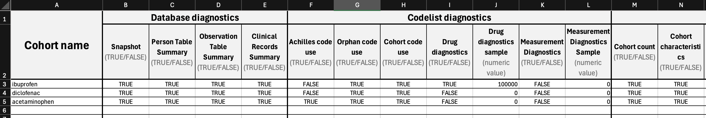

---
title: "PhenotypeRSpecifications"
output: rmarkdown::html_vignette
vignette: >
%\VignetteIndexEntry{PhenotypeRSpecifications}
  %\VignetteEngine{knitr::rmarkdown}
  %\VignetteEncoding{UTF-8}
  ---
  
  ```{r, include = FALSE}
  knitr::opts_chunk$set(
  collapse = TRUE,
  comment = "#>"
  )
  ```
  
  ```{r setup}
  library(PhenotypeR)
```

## Define diagnostics

`newPhenotypeRSpecifications()` stores the settings for each diagnostic.
Populate the arguments as you would do with the `phenotypeDiagnostics()`.
One named list for a single configuration or a list of named lists for several
configurations. Use character cohort ids with the name of the cohort so the
arguments can keep tracked correctly.

```{r}
specifications <- newPhenotypeRSpecifications(
  populationDiagnostics = list(
    cohortId = "ibuprofen",
    incidence = TRUE,
    periodPrevalence = TRUE,
    populationSample = 100000,
    populationDateRange = as.Date(c("2015-01-01", "2020-12-31"))
  )
)

specifications
```

## Export and import

Specifications can be exported to and imported from Excel or JSON.

In Excel, leave all columns for a diagnostic blank to skip it for that cohort.
Within a populated diagnostic block, blank cells use the argument defaults.
Enabled diagnostics are exported with their default values filled in.

```{r, eval = FALSE}
exportPhenotypeRSpecifications(
  specifications,
  fileName = "my_specifications",
  path = tempdir(),
  type = "excel"
)

importPhenotypeRSpecifications(
  file.path(tempdir(), "my_specifications.xlsx")
)
```

To populate some specifications for a given study you can start exporting an
empty specifications file, modifying it and importing later to run diagnostics.

Export empty diagnostics:

```{r}
exportPhenotypeRSpecifications(
  newPhenotypeRSpecifications(),
  fileName = "my_specifications",
  path = tempdir(),
  type = "excel"
)
```

Populate in the excel spreadsheet:



Import it back:

```{r, echo=FALSE}
diag <- newPhenotypeRSpecifications(
  databaseDiagnostics = list(
    cohortId = c("ibuprofen", "diclofenac", "acetaminophen"),
    snapshot = TRUE,
    personTableSummary = TRUE,
    observationPeriodsSummary = TRUE,
    clinicalRecordsSummary = TRUE
  ),
  codelistDiagnostics = list(
    list(
      cohortId = "ibuprofen",
      achillesCodeUse = FALSE,
      orphanCodeUse = TRUE,
      cohortCodeUse = TRUE,
      drugDiagnostics = TRUE,
      drugDiagnosticsSample = 100000,
      measurementDiagnostics = FALSE,
      measurementDiagnosticsSample = 0
    ),
    list(
      cohortId = "diclofenac",
      achillesCodeUse = FALSE,
      orphanCodeUse = TRUE,
      cohortCodeUse = TRUE,
      drugDiagnostics = FALSE,
      drugDiagnosticsSample = 0,
      measurementDiagnostics = FALSE,
      measurementDiagnosticsSample = 0
    ),
    list(
      cohortId = "acetaminophen",
      achillesCodeUse = TRUE,
      orphanCodeUse = TRUE,
      cohortCodeUse = TRUE,
      drugDiagnostics = FALSE,
      drugDiagnosticsSample = 0,
      measurementDiagnostics = FALSE,
      measurementDiagnosticsSample = 0
    )
  ), 
  cohortDiagnostics = list(
    cohortId = c("ibuprofen", "diclofenac", "acetaminophen"),
    cohortCount = TRUE,
    cohortCharacteristics = TRUE
  )
)
exportPhenotypeRSpecifications(
  diag,
  fileName = "my_specifications",
  path = tempdir(),
  type = "excel"
)
```

```{r}
diag <- importPhenotypeRSpecifications(file.path(tempdir(), "my_specifications.xlsx"))
diag
```

Run diagnostics:

```{r, message=FALSE}
library(omock)
library(CohortConstructor)

cdm <- mockCdmFromDataset(source = "duckdb")

cdm$my_cohort <- conceptCohort(
  cdm = cdm,
  name = "my_cohort",
  conceptSet = list(
    acetaminophen = 1127433L, 
    ibuprofen = 19078461L,
    diclofenac = 1124300L
  )
)

result <- phenotypeDiagnostics(
  cohort = cdm$my_cohort,
  databaseDiagnostics = diag$databaseDiagnostics,
  codelistDiagnostics = diag$codelistDiagnostics,
  cohortDiagnostics = diag$cohortDiagnostics,
  populationDiagnostics = diag$populationDiagnostics
)
```

Note the cohort table must contain cohort with the same name specified in the
PhenotypeR Specifications so PhenotypeR works properly.
